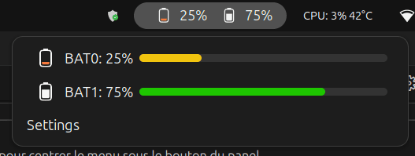

<!-- markdownlint-disable MD033 MD041 -->

# Dual Battery Monitor

**Display the charge of every battery of your laptop, side by side, in the GNOME top panel.**
Built for laptops with two batteries (BAT0 / BAT1), compatible with GNOME Shell 45 through 50.

 

  

## Features

- **One indicator per battery** in the top panel, with percentage and charging state
- **Popup menu with charge bars**, colored by level (low < 20 %, medium < 50 %, high)
- **Configurable display**: show or hide battery names and icons
- **Configurable position**: far left, left, center, right or far right of the top panel

## Acknowledgements

- Thanks to [@RaddedMC](https://github.com/RaddedMC) for improving the extension and contributing to this project!
